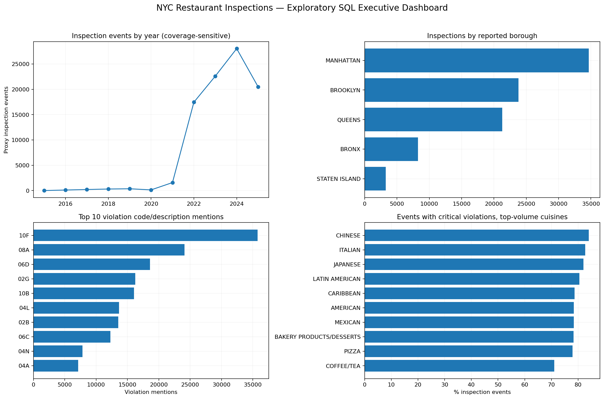

# NYC Restaurant Food Safety — SQL Inspection Intelligence

## Business objective
Evaluate NYC restaurant inspection violations, grades, cuisines, boroughs, and geographic/time patterns to support equitable and effective food-safety policy.

## Dataset and definitions
- Raw file: `DOHMH_New_York_City_Restaurant_Inspection_Results_20250919.csv`; raw records parsed: **288,888**.
- Analytical proxy inspection events: **91,316**, excluding **3,699** events dated `1900-01-01` as suspected administrative/default dates pending confirmation against the source Data Dictionary. The raw-source date range is **1900-01-01** to **2025-09-16**, while the analytical annual export begins in **2015**. See `nyc_inspection_placeholder_date_audit.csv` for the excluded records; raw source records are retained for auditing.
- A source row generally represents an inspection-violation record, **not necessarily one inspection**.
- An inspection event is approximated by `CAMIS + inspection date + inspection type`; repeated same-day inspections of one type may be merged. No verified encounter identifier exists.
- Scores represent **violation points** (higher is worse), not satisfaction or performance points. Grade analysis includes A/B/C where present; unassigned/other grade events are counted separately.
- Critical status is reported status, not a causal measure. Missing values are unknown, not automatically non-critical.
- ZIP code is a geographic proxy, **not a verified neighborhood**.
- Outputs cover the actual source extract, **not necessarily all current NYC restaurants**. Avoid comparing annual totals without ensuring complete matching periods.

## Executive quality audit
| source_rows | missing_camis | missing_inspection_dates | unknown_borough_rows | missing_zip_rows | missing_street_rows | unknown_cuisine_rows | missing_grade_rows | missing_score_rows | no_violation_description_rows | missing_critical_flag_rows | earliest_inspection | latest_inspection |
| --- | --- | --- | --- | --- | --- | --- | --- | --- | --- | --- | --- | --- |
| 288888 | 0 | 0 | 15 | 2908 | 0 | 3699 | 148044 | 15926 | 5851 | 0 | 1900-01-01 00:00:00 | 2025-09-16 00:00:00 |

## Event-key audit
| inspection_events | source_rows_in_events | conflicting_grades | conflicting_scores | conflicting_boroughs | conflicting_cuisines | multi_row_inspections |
| --- | --- | --- | --- | --- | --- | --- |
| 91316 | 285189.0 | 0.0 | 2.0 | 0.0 | 0.0 | 72201.0 |

## Annual inspection trend
| year | inspection_events | graded_events | avg_violation_score | pct_a_among_abc |
| --- | --- | --- | --- | --- |
| 2015 | 9 | 3 | 12.86 | 100.0 |
| 2016 | 112 | 72 | 10.38 | 97.22 |
| 2017 | 213 | 145 | 10.78 | 93.79 |
| 2018 | 310 | 181 | 12.41 | 91.71 |
| 2019 | 360 | 233 | 13.52 | 93.99 |
| 2020 | 140 | 73 | 17.11 | 82.19 |
| 2021 | 1584 | 835 | 15.07 | 94.97 |
| 2022 | 17453 | 9853 | 15.23 | 89.34 |
| 2023 | 22594 | 13002 | 17.34 | 85.84 |
| 2024 | 28033 | 15734 | 18.01 | 85.8 |
| 2025 | 20508 | 10185 | 19.4 | 88.86 |

## Inspections and grades by borough
| borough | inspection_events | graded_events | pct_a_among_abc | avg_violation_score | pct_events_with_critical |
| --- | --- | --- | --- | --- | --- |
| MANHATTAN | 34676 | 19258 | 88.95 | 16.84 | 76.49 |
| BROOKLYN | 23811 | 13244 | 87.44 | 17.57 | 78.09 |
| QUEENS | 21296 | 11403 | 85.39 | 18.67 | 78.86 |
| BRONX | 8265 | 4540 | 85.02 | 17.27 | 79.25 |
| STATEN ISLAND | 3268 | 1871 | 88.4 | 16.64 | 83.2 |

## NYC grade distribution
| grade_group | inspection_events |
| --- | --- |
| A | 43961 |
| UNASSIGNED/OTHER | 41000 |
| B | 4229 |
| C | 2126 |

## Most frequent inspection types
| inspection_type | inspection_events |
| --- | --- |
| CYCLE INSPECTION / INITIAL INSPECTION | 45455 |
| CYCLE INSPECTION / RE-INSPECTION | 18109 |
| PRE-PERMIT (OPERATIONAL) / INITIAL INSPECTION | 10146 |
| ADMINISTRATIVE MISCELLANEOUS / INITIAL INSPECTION | 6430 |
| PRE-PERMIT (OPERATIONAL) / RE-INSPECTION | 3291 |
| ADMINISTRATIVE MISCELLANEOUS / RE-INSPECTION | 1359 |
| CYCLE INSPECTION / REOPENING INSPECTION | 1302 |
| PRE-PERMIT (NON-OPERATIONAL) / INITIAL INSPECTION | 1127 |
| INTER-AGENCY TASK FORCE / INITIAL INSPECTION | 755 |
| SMOKE-FREE AIR ACT / INITIAL INSPECTION | 531 |

## Top 10 violation mentions
| violation_code | violation_description | mentions | critical_mentions |
| --- | --- | --- | --- |
| 10F | Non-food contact surface or equipment made of unacceptable material, not kept clean, or not properly sealed, raised, spaced or movable to allow accessibility for cleaning on all sides, above and underneath the unit. | 35758 | 0 |
| 08A | Establishment is not free of harborage or conditions conducive to rodents, insects or other pests. | 24103 | 0 |
| 06D | Food contact surface not properly washed, rinsed and sanitized after each use and following any activity when contamination may have occurred. | 18596 | 18596 |
| 02G | Cold TCS food item held above 41 °F; smoked or processed fish held above 38 °F; intact raw eggs held above 45 °F; or reduced oxygen packaged (ROP) TCS foods held above required temperatures except during active necessary preparation. | 16240 | 16240 |
| 10B | Anti-siphonage or back-flow prevention device not provided where required; equipment or floor not properly drained; sewage disposal system in disrepair or not functioning properly. Condensation or liquid waste improperly disposed of. | 16045 | 0 |
| 04L | Evidence of mice or live mice in establishment's food or non-food areas. | 13647 | 13647 |
| 02B | Hot TCS food item not held at or above 140 °F. | 13557 | 13557 |
| 06C | Food, supplies, or equipment not protected from potential source of contamination during storage, preparation, transportation, display, service or from customer’s refillable, reusable container. Condiments not in single-service containers or dispensed directly by the vendor. | 12290 | 12290 |
| 04N | Filth flies or food/refuse/sewage associated with (FRSA) flies or other nuisance pests in establishment’s food and/or non-food areas. FRSA flies include house flies, blow flies, bottle flies, flesh flies, drain flies, Phorid flies and fruit flies. | 7815 | 7815 |
| 04A | Food Protection Certificate (FPC) not held by manager or supervisor of food operations. | 7153 | 7153 |

A single event may contain multiple different violation mentions. Mentions are not unique restaurants or inspections.

## Critical vs non-critical violation rows
| critical_status | violation_rows |
| --- | --- |
| CRITICAL | 153139 |
| NOT CRITICAL | 128156 |
| OTHER/UNKNOWN | 1742 |

## Highest-scoring cuisines (worse reported violation points)
Uses at least 30 proxy inspection events per cuisine; exploratory only, not an exposure-adjusted restaurant risk estimate.
| cuisine | inspection_events | avg_violation_score | pct_a_among_abc | pct_events_with_critical |
| --- | --- | --- | --- | --- |
| BANGLADESHI | 356 | 29.84 | 58.41 | 76.69 |
| CREOLE | 106 | 25.81 | 53.49 | 83.96 |
| AFRICAN | 373 | 24.94 | 67.61 | 75.6 |
| PAKISTANI | 141 | 24.82 | 62.07 | 78.01 |
| FILIPINO | 157 | 24.76 | 55.93 | 73.89 |

## ZIP / geographic analysis
`nyc_inspection_zip_summary.csv` includes ZIP-level proxy event counts and rates. Borough counts are not per-restaurant risk rates; repeated inspections are common, and restaurant mix varies.

## Methodology and validation
1. Scan large CSV using DuckDB SQL with nullable, tolerant parsing; irrecoverably malformed rows may be skipped and must be separately reconciled for official reporting.
2. Inspect fields against the supplied data dictionary and audit missing dates, boroughs, ZIP codes, cuisines, and grades.
3. Standardize commonly equivalent cuisine labels conservatively and convert inspection/grade dates.
4. Construct proxy inspection-level events to avoid counting violation rows as separate inspections.
5. Audit conflicting grades, scores, boroughs and cuisines within inspection events. Conflicting A/B/C grades are unassigned rather than arbitrarily selected.
6. Generate SQL summaries; reconcile event totals between annual, borough and grade exports.
7. Save charts, CSV outputs, recommendations and a ZIP package.

## Business recommendations
See [RECOMMENDATIONS.md](RECOMMENDATIONS.md) for seven prioritized, measurable recommendations. Largest raw volume is not the same as greatest safety risk.

## Technology
Python, DuckDB SQL, pandas, NumPy, Matplotlib and Google Colab. This release includes a static Python dashboard and Power BI-ready CSVs; **no finished Power BI report**.

## Reproduction
1. Obtain the NYC DOHMH restaurant inspection CSV from the original assignment or authorized NYC open-data source, verify the data dictionary and licensing.
2. Upload `NYC_Restaurant_Inspection_SQL_Analysis.ipynb` to Google Colab.
3. Upload the source CSV to `/content` or Google Drive; set `DATA_FILE` in Cell 1 if needed.
4. Run cells 1–7 and check printed `VALIDATION: PASS` and `PACKAGE READY` messages.
5. Read exports from `/content/NYC_Project8_Outputs`. Download the notebook `.ipynb` separately and add it to the extracted ZIP files before GitHub publishing.

## Limitations
Data feed may contain updated, administrative, and ungraded records; the proxy event key may merge inspections. Missing grades are not failures. Cuisine normalization is limited; score differences may reflect inspection type and selection effects. Annual trends may have incomplete boundary-year coverage. ZIP codes are not neighborhoods. Rates by borough or cuisine are conditioned on recorded inspections, not all restaurants. No official individual-restaurant or neighborhood risk ranking is claimed. The original raw CSV is excluded from the ZIP by default because of its possible large size.

## GitHub publishing
**Repository:** `NYC-Restaurant-Food-Safety-Inspection-Analytics`  
**Description:** SQL-based NYC restaurant inspection analytics exploring food safety violations, grades, cuisine patterns, geographic differences, and targeted policy actions.  
**Create repository:** https://github.com/new
